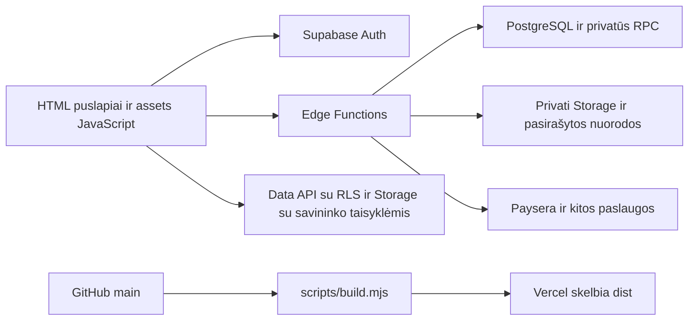

# Architektūra

Tai žemėlapis darbui su dabartine realizacija. Konkretaus diegimo faktai saugomi [PROJECT_STATE.md](PROJECT_STATE.md), tikslūs importai — [GENERATED_MAP.md](GENERATED_MAP.md).

## Pagrindinės dalys

Naršyklė kai kuriuos leidžiamus lentelių ir Storage veiksmus atlieka tiesiogiai su vartotojo žetonu. RLS ir serverio RPC apsaugo duomenis. Viešas profilis, mokėjimai ir administravimo automatika turi papildomas Edge patikras. `service_role` naudojamas tik serveryje.

## Kur redaguoti

| Dalis | Šaltinis | Kaip vykdoma |
| --- | --- | --- |
| Puslapio struktūra ir skriptų tvarka | Šakniniai `.html` failai | Naršyklė, statiniai vieši adresai |
| Sąsajos ir užklausų logika | `assets/*.js` | IIFE ir vardiniai `window` objektai; [frontend aprašas](FRONTEND.md) |
| Stiliai | `css/*.css` | Bendri ir konkrečių srautų CSS |
| API ir integracijos | `supabase/functions/*/index.ts` | Atskirai įdiegiamos Deno Edge Functions |
| Bendra serverio logika | `supabase/functions/_shared/*.ts` | Funkcijos importuoja ir gauna savo diegimo kopiją |
| DB elgesys | `supabase/migrations/*.sql` | RLS, RPC, trigeriai ir katalogai; [backend aprašas](BACKEND.md) |
| Viešinimo rinkinys | [build.mjs](../scripts/build.mjs) ir [vercel.json](../vercel.json) | Iš šaltinių sukuria `dist/`; turi failų leidžiamą sąrašą |
| Vietinė peržiūra | [serve.py](../serve.py) | Statiniai failai, 127.0.0.1:5000 |
| Papildomas vietinis API | [app.py](../app.py) | Flask; produkcijoje nepaleidžiamas |
| Patikros | `tests/` ir `supabase/functions/**/*test.ts` | Node, Python, Deno, atskirai naršyklė / SQL |

## Svarbiausi srautai

1. **Užsakymas:** parduotuvė → redaktorius → profilis / užsakymas → pristatymo ir mokėjimo puslapis → Paysera → serverinis webhook → kliento zona / automatika. Kainą ir apmokėjimą nustato serveris.
2. **Atminimo peržiūra:** QR adresas `sablonas-viskas.html` → duomenų pagalbinis modulis → `profile-content` → prieigos ir kodo patikra → pasirašytos failų nuorodos → turinio atvaizdavimas. Grupės naudojasi tais pačiais savininko ir privatumo apribojimais.
3. **Prisijungimas:** Auth → sesija `sessionStorage` → tikros rolės nuskaitymas → administratoriui MFA → leidžiami RLS ir Edge veiksmai. Nukreipimas naršyklėje nepakeičia serverinės apsaugos.
4. **Kapavietės priežiūra:** vieša forma / preliminarus įvertis → `service-flow` → administratoriaus pasiūlymas → savininko priėmimas ir apmokėjimas. Svečių užklausos ir autentifikuoti veiksmai turi skirtingas ribas.
5. **Paieška:** `official-grave-search.js` → `cemetery-search` → vieši išoriniai šaltiniai. Senas importo kodas paliktas istorijai; neįjunkite jo kaip naujo produkcijos duomenų šaltinio vien pagal failo buvimą.

## Bendri susitarimai

- HTML skriptų įkėlimo tvarka ir esami `window` vardai yra realios priklausomybės. Šiuo metu nėra React, kliento paketų rinkimo ar ES modulių migracijos.
- `build.mjs` minifikuoja JS / CSS, bet nesujungia visų skriptų į vieną paketą. Jis perskaičiuoja `?v=` iš turinio ir išlaiko vykdymo tvarką.
- Naujas JS / CSS šiuo metu turi būti tiesiogiai `assets/` / `css/`, nes build nerenka jų subkatalogių. Nauji vieši failų tipai turi būti įtraukti į leidžiamą sąrašą.
- CSS selektoriai, HTML `id`, `data-*`, saugyklų raktai ir užklausų JSON yra sutartys tarp puslapių / modulių. Prieš pervadindami ieškokite jų naudojimo su `rg`.
- Sėkmingas frontend push neįdiegia DB ir Edge pakeitimų. Vien `_shared` failo redagavimas neatnaujina jau veikiančių funkcijų.

## Pakeitimo eiga naujam pokalbiui

Suraskite srautą aukščiau → [frontend](FRONTEND.md) arba [backend](BACKEND.md) → konkretus failas ir jo vartotojai [žemėlapyje](GENERATED_MAP.md) → atitinkami testai. Pirmiausia keiskite tą ribą, kuriai priklauso elgesys: sąsaja, duomenų adapteris, Edge ar DB. Po pakeitimo atnaujinkite tik faktiškai pasikeitusią dokumentaciją.
